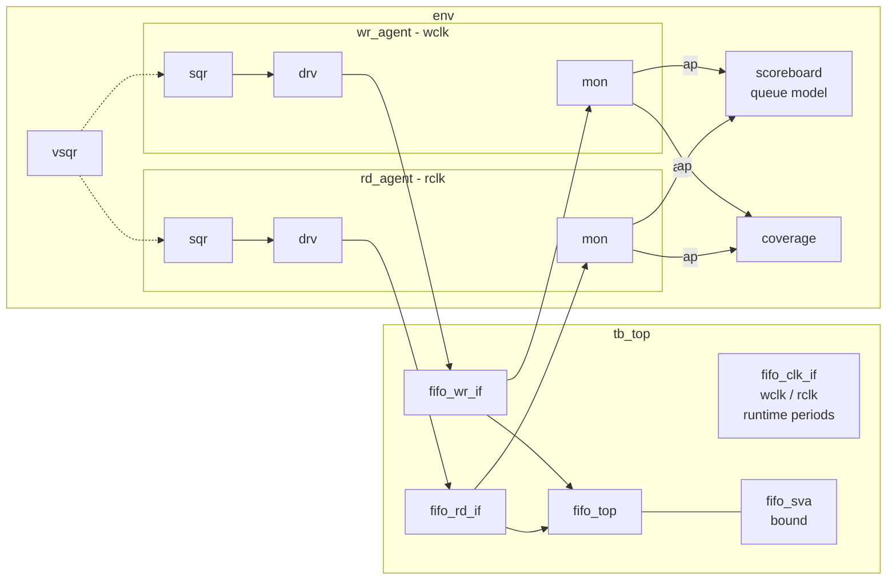

# UVM Verification of a Parameterized Asynchronous FIFO

A synthesizable dual-clock FIFO (Gray-coded pointers, 2-flop synchronizers,
full/empty plus almost-full/almost-empty) and a complete UVM testbench for it:
two clock-domain agents, a queue-based scoreboard, functional coverage, bound
SVA, virtual sequences, and seven tests.

The full UVM testbench runs on an **open-source simulator** (Verilator 5.x
with the CHIPS Alliance UVM port). Every result below was produced in that
flow. Makefile targets for Questa, VCS and Xcelium are included but **have
not been run**; see [What was actually run](#what-was-actually-run).

- Design and verification rationale, plus interview Q&A: [`docs/WALKTHROUGH.md`](docs/WALKTHROUGH.md)
- Feature to test/checker/coverage mapping: [`docs/verification_plan.md`](docs/verification_plan.md)

---

## DUT

```
                 wclk domain                 :                 rclk domain
                                             :
  winc  ──►┌─────────────┐ waddr ┌───────────┴───────────┐ raddr ┌──────────────┐◄── rinc
  wdata ──►│  wptr_full  │──────►│       fifo_mem        │◄──────│  rptr_empty  │──► rempty
  wfull ◄──│ bin + Gray  │       │  write @wclk          │       │  bin + Gray  │──► ralmost_empty
  walmost_full ◄──│      │       │  read: async (FWFT)   │──────►│              │
           └──┬───────▲──┘       └───────────┬───────────┘ rdata └──▲────────┬──┘
         wptr │       │ wq2_rptr             :            rq2_wptr │        │ rptr
       (Gray) │       │                      :                     │        │ (Gray)
              │   ┌───┴──────┐               :               ┌─────┴────┐   │
              │   │ sync_r2w │◄──────────────:───────────────┼──────────┼───┘
              │   │ 2 flops  │               :               │ sync_w2r │
              └───┼──────────┼───────────────:──────────────►│ 2 flops  │
                  └──────────┘               :               └──────────┘
```

| Parameter | Default | Meaning |
|-----------|---------|---------|
| `DATA_WIDTH` | 8 | entry width |
| `ADDR_WIDTH` | 4 | depth = 2**ADDR_WIDTH (>= 2) |
| `ALMOST_FULL_THRESH` | depth-2 | `walmost_full` when write-side occupancy >= this |
| `ALMOST_EMPTY_THRESH` | 2 | `ralmost_empty` when read-side occupancy <= this |

Ports: `wclk wrst_n winc wdata wfull walmost_full` / `rclk rrst_n rinc rdata rempty ralmost_empty`.
Reads are first-word fall-through. Writes when full and reads when empty are
ignored. Both domains have async-assert active-low resets, which must be
applied together.

## Testbench



| Component | File | Notes |
|-----------|------|-------|
| Write / read agents | `tb/agents/{write,read}_agent/` | item, config object (holds vif), driver, monitor, agent, sequences |
| Scoreboard | `tb/env/fifo_scoreboard.svh` | queue reference model; data/order compare; overflow/underflow; flag-safety on every edge; leftover check |
| Coverage | `tb/env/fifo_coverage.svh` | ops (incl. write-when-full/read-when-empty), flags and transitions, fill level, data patterns, simultaneous access, clock ratio crosses |
| Virtual sequences | `tb/seq/` | fill/drain helpers, exact flag checks at quiet points, scenario sequences |
| Tests | `tb/tests/` | base test (reset, watchdog, PASS/FAIL) and seven tests |
| SVA | `tb/sva/fifo_sva.sv`, `fifo_bind.sv` | reset values, Gray single-bit change, pointer protocol, no-write-when-full memory check, flag causality, 2-stage sync, covers |
| Top | `tb/top/tb_top.sv`, `tb/if/` | clock generator with plusargs, interfaces with clocking blocks |

### Tests

| Test | What it does |
|------|--------------|
| `fifo_smoke_test` | 8 known values (incl. 00/FF/55/AA) in and out; flags after reset, after writes, after reads |
| `fifo_random_test` | 4 iterations of concurrent random writer and reader (random lengths and gaps), then drain |
| `fifo_full_empty_test` | Level walk 0→16→0 one entry at a time with exact flag checks at every level; probe write when full and read when empty; 2 burst fill/drain cycles (pointer wrap) |
| `fifo_overflow_underflow_test` | Reads on empty after reset; fill plus N extra writes (all must drop, exactly DEPTH come out); reads on empty again; overflow again from a wrapped pointer offset |
| `fifo_simul_rw_test` | Prefill to half, then back-to-back writer and reader concurrently |
| `fifo_clock_ratio_test` | Sweeps 5 clock configs in one run (wclk 4.25x faster, 1.3x faster, equal, rclk 1.3x faster, rclk 4.25x faster), re-reset per config, overflow/underflow + simultaneous + random at each |
| `fifo_reset_test` | 3x: assert both resets at a random point during random traffic, check flags in reset, recover, smoke transfer |

## How to run

### Open-source flow (Verilator + UVM): used for every result below

```bash
# 1. Toolchain (once): builds Verilator master and clones chipsalliance/uvm-verilator
#    Ubuntu: sudo apt-get install git make autoconf g++ flex bison libfl-dev help2man \
#                                 perl python3 zlib1g-dev libgoogle-perftools-dev z3
sim/setup_verilator.sh
export VERILATOR_ROOT=$PWD/third_party/verilator
export PATH=$VERILATOR_ROOT/bin:$PATH

cd sim
make lint                                             # Verilator -Wall on the RTL
make SIM=verilator TEST=fifo_smoke_test               # build (~3 min first time) + run
make SIM=verilator TEST=fifo_random_test SEED=42 VERBOSITY=UVM_HIGH
make SIM=verilator TEST=fifo_smoke_test WCLK_PS=4000 RCLK_PS=17000   # any clock ratio
make SIM=verilator DATA_WIDTH=5 ADDR_WIDTH=3 TEST=fifo_full_empty_test
./run_regression.sh --seeds "1 2 3"                   # all tests x seeds, PASS/FAIL table
make coverage                                         # merge coverage.dat, list unhit bins
```

`UVM_HOME` defaults to `third_party/uvm-verilator/src`; override it if your
UVM source is elsewhere. `make DUMP=1 ...` writes `waves.vcd`; add `--trace`
to `VERILATOR_FLAGS` to enable tracing in the Verilator build.

### Commercial simulators (targets provided, not run)

```bash
make SIM=questa  TEST=fifo_random_test SEED=7
make SIM=vcs     TEST=fifo_clock_ratio_test
make SIM=xcelium TEST=fifo_reset_test
./run_regression.sh --sim questa --seeds "1 2 3 4 5"
```

These use each tool's bundled UVM. The code avoids simulator-specific
constructs, but the command lines have not been exercised and may need
small adjustments for your tool version.

## What was actually run

**Tool:** Verilator `5.053 devel` (built from `verilator/verilator` master,
commit `a89aa64`, 2026-10-06), UVM from `chipsalliance/uvm-verilator`
(Accellera UVM 2020.3.2 adapted for Verilator, commit `5d72b66`), z3 4.8.12
as the constraint solver, on Ubuntu 24.04 / x86-64.

**RTL lint:** `verilator --lint-only -Wall` on all RTL: clean (no warnings).

**Regression** (`./run_regression.sh --seeds "1 2 3"`, default config
DATA_WIDTH=8, DEPTH=16, wclk 10 ns / rclk 13 ns except where the test changes it):

| Test | Seed 1 | Seed 2 | Seed 3 | Scoreboard (seed 1) |
|------|--------|--------|--------|---------------------|
| fifo_smoke_test | PASS | PASS | PASS | 8 writes / 8 reads / 0 mismatches |
| fifo_random_test | PASS | PASS | PASS | 508 / 508 / 0 |
| fifo_full_empty_test | PASS | PASS | PASS | 48 / 48 / 0 |
| fifo_overflow_underflow_test | PASS | PASS | PASS | 40 / 40 / 0 |
| fifo_simul_rw_test | PASS | PASS | PASS | 112 / 112 / 0 |
| fifo_clock_ratio_test | PASS | PASS | PASS | 1096 / 1096 / 0 |
| fifo_reset_test | PASS | PASS | PASS | 563 written / 532 read / 0 mismatches (difference = data discarded by mid-traffic resets, by design) |

21/21 runs passed: zero `UVM_ERROR`/`UVM_FATAL`, zero SVA failures.

**Functional coverage** (Verilator covergroups, all 21 runs merged with
`verilator_coverage`, reported by `sim/cov_report.py`):

| Covergroup | Bins hit |
|------------|----------|
| cg_wr | 46 / 46 |
| cg_rd | 46 / 46 |
| cg_wr_data | 6 / 6 |
| cg_rd_data | 6 / 6 |

All 8 SVA cover properties (`C1`..`C8`) were hit. `fifo_clock_ratio_test`
alone reaches 100% of all four covergroups; other single tests are lower,
as expected (e.g. smoke runs at a single clock ratio).

**Other configuration:** see [Non-default parameters](#non-default-parameters) below.

### Mutation testing

To show the checkers find real bugs, each bug below was injected into a
copy of the RTL and five tests were re-run (smoke, full_empty,
overflow_underflow, random, reset). "Caught" means the test failed with the
listed checker(s) firing.

| Mutant | Bug | Caught by (tests) | Checkers that fired |
|--------|-----|-------------------|---------------------|
| M1 | `wptr_full`: pointer advances on write-when-full | full_empty, overflow_underflow, random, reset (not smoke: it never fills) | SB_OVERFLOW, SB_WFULL, FLAGS, SVA F2 / P3 |
| M2 | `wptr_full`: full compare without inverting the 2 MSBs | all 5 | SVA F3 |
| M3 | `wptr_full`: binary pointer sent across instead of Gray | all 5 | SVA G1, SB_RAEMPTY, FLAGS |
| M4 | `rptr_empty`: `rempty` resets to 0 | all 5 | SVA R3 |
| M5 | `fifo_mem`: data inverted at address 3 | all 5 | SB_MISMATCH |
| M6 | `sync_w2r`: single synchronizer flop | smoke, random (the 2 tests re-run after adding S1/S2) | SVA S1 |
| M7 | `wptr_full`: almost-full `>` instead of `>=` | full_empty, overflow_underflow, random, reset | SB_WAFULL, FLAGS |

M1-M5 and M7 were run before `S1`/`S2` were added. Adding those assertions
only adds checks, so these mutants still fail.

**M6 initially passed every test.** Functional simulation has no
metastability, so a one-flop synchronizer is functionally invisible. That
result led to adding SVA `S1`/`S2` (synchronized pointer == source pointer
two destination edges earlier); after that, M6 fails on the first transfer.
See WALKTHROUGH sections 2, 14 and 16.

### Not run / caveats

* **Questa, VCS, Xcelium:** no licenses in this environment. Makefile targets
  are provided but untested.
* **Verilator UVM is recent work.** It needed Verilator master; Ubuntu's
  packaged 5.020 is too old. The flow was not tried with a tagged release.
* **Verilator limitations encountered:** per-coverpoint
  `get_inst_coverage()` is not supported, so the TB reports per-covergroup
  percentages and `cov_report.py` lists unhit bins from `coverage.dat`.
  Verilator is 2-state for this flow, so X-propagation is not checked.
* **No metastability modeling, CDC tool run, gate-level or formal.** See
  `docs/verification_plan.md` section 5.
* Coverage closure here is measured on this testbench's own coverage model;
  it does not imply code coverage (line/toggle/branch was not collected).

## Non-default parameters

The same testbench compiles with any `DATA_WIDTH` and `ADDR_WIDTH >= 3`
through `+define` (see `fifo_tb_params_pkg.sv`). Measured run:

`make SIM=verilator DATA_WIDTH=5 ADDR_WIDTH=3 SEED=5 WCLK_PS=7000 RCLK_PS=23000 TEST=<t>`
(DEPTH=8, AF=6, AE=2, write clock 3.3x faster):

| Test | Result | Scoreboard |
|------|--------|------------|
| fifo_smoke_test | PASS | 8 / 8 / 0 mismatches |
| fifo_full_empty_test | PASS | 24 / 24 / 0 |
| fifo_random_test | PASS | 381 / 381 / 0 |
| fifo_overflow_underflow_test | PASS | 20 / 20 / 0 |

## Repository layout

```
rtl/        fifo_top, fifo_mem, sync_r2w, sync_w2r, wptr_full, rptr_empty
tb/common/  fifo_tb_params_pkg (widths, thresholds, data patterns)
tb/if/      clock, write and read interfaces
tb/agents/  write_agent/, read_agent/ (item, cfg, driver, monitor, agent, seqs, pkg)
tb/env/     env cfg, scoreboard, coverage, virtual sequencer, env, pkg
tb/seq/     base virtual sequence + scenario virtual sequences
tb/tests/   base test + 7 tests
tb/sva/     fifo_sva checker + bind
tb/top/     tb_top
sim/        Makefile, files.f, run_regression.sh, setup_verilator.sh, cov_report.py
docs/       WALKTHROUGH.md, verification_plan.md
```

## References

* C. E. Cummings, "Simulation and Synthesis Techniques for Asynchronous FIFO
  Design," SNUG 2002.
* C. E. Cummings, "Clock Domain Crossing (CDC) Design & Verification
  Techniques Using SystemVerilog," SNUG 2008.
* IEEE 1800-2017 (SystemVerilog), IEEE 1800.2-2020 (UVM).
* Verilator: https://github.com/verilator/verilator, UVM for Verilator:
  https://github.com/chipsalliance/uvm-verilator

## License

MIT, see [LICENSE](LICENSE).
